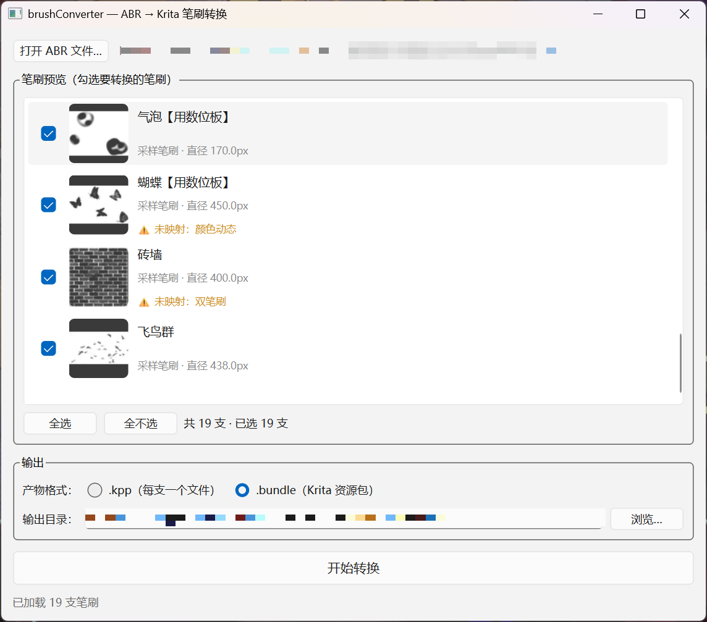

# brushConverter

Convert Photoshop brush sets (`.abr`) into Krita brushes (`.kpp` presets / `.bundle` resource packs), with automatic brush-parameter mapping. Ships as both a command-line tool and a PySide6 GUI. **v1.3.0**

Photoshop 笔刷（`.abr`）转 Krita 笔刷（`.kpp` / `.bundle`）工具，支持参数自动映射，提供命令行与图形界面两种方式。

## 使用指南

### 图形界面



打开 .abr → 预览每支笔尖缩略图与名称 → 勾选要转换的笔刷（支持全选/全不选）→ 选择产物格式（`.kpp` 每支一个文件，或 `.bundle` Krita 资源包）→ 选择输出目录 → 点击"开始转换"。含未映射参数（双笔刷/颜色动态/湿边等）的笔刷会有 ⚠ 标注，转换时会先弹窗提醒确认。纹理（`patt`）已支持：47 个 Photoshop 纹理混合模式已逐个定论（22 可映射 / 1 需校准 / 24 不可映射，见下文「已知不可映射模式」）；使用纹理的笔刷在转换前会弹窗说明「纹理亮度/对比度已按 Photoshop 公式校准（calibrated 方案，v1.2.0 起默认）」与模式映射情况，并列出仍存在的结构性限制。右上角可随时切换界面语言（中文 / English）。

下载 `brushConverter-*-win64.zip`（见 [releases](https://github.com/yxm1122/brushConverter/releases)），解压后双击 `brushConverter.exe` 即可使用。

### 命令行

下载 `brushconverter-cli-*-win64.zip` 解压后，在命令行使用 `brushconverter-cli.exe`：

```bash
brushconverter-cli.exe convert <file.abr> -o 输出目录                # 批量转换为 Krita 预设/资源包
brushconverter-cli.exe info <file.abr>                              # 查看笔刷概况（版本/区段/笔尖）
brushconverter-cli.exe extract <file.abr> -o out/ [--contact-sheet] # 导出笔尖 PNG + 总览图
```

## 环境

```
conda activate brushConverter      # Python 3.12, 含 numpy + pillow + pyside6
pip install -r requirements.txt    # 补充依赖（含 pyinstaller）
```

## 用法

```bash
python cli.py gui                                                # 启动图形界面
python cli.py info <file.abr>                                    # 打印版本/区段/笔尖列表
python cli.py extract <file.abr> -o out/ [--contact-sheet]       # 导出 PNG + info.json
python cli.py convert <file.abr> -o out/                         # 命令行批量转换
```

## 打包

项目根目录的 `*.spec` 是 PyInstaller 配置，`--onedir` 模式输出两个目录：

```bash
pyinstaller brushconverter-cli.spec    # → dist/brushconverter-cli/brushconverter-cli.exe  (62 MB, 无 GUI 依赖)
pyinstaller brushconverter-gui.spec    # → dist/brushConverter/brushConverter.exe  (155 MB, 含 PySide6)
```

- 应用图标：`assets/brushConverter.ico`（自绘蓝紫渐变 + 转换箭头 + 笔刷墨点）。
- CLI 入口：`cli.py`（console 模式）；GUI 入口：`brushConverter_gui_entry.py`（避免 `gui/__main__.py` 的开发期 sys.path hack）。
- 重新打包前可加 `--clean` 清理 `build/` 与 `dist/`。

## GUI 功能

- 打开 .abr，预览每支笔刷的笔尖缩略图与名称；
- 勾选要转换的笔刷（支持全选/全不选）；
- 产物可选 `.kpp`（每支一个文件）或 `.bundle`（Krita 资源包）；
- 含双笔刷/颜色动态/湿边等无法映射参数的笔刷会弹出提醒；
- 使用纹理的笔刷在转换前提示：纹理亮度/对比度已按 Photoshop 公式校准（calibrated 默认）；47 个纹理混合模式中 22 个已可映射、1 个需校准、24 个不可映射（不可映射的按正片叠底近似并保留警告）；同时说明仍存在的结构性限制（PS 对比度 > 50、PS 深度 > 83% 等）；
- 右上角语言切换（中文 / English），选择会记住（QSettings）。

## 转换说明

- 支持 v1/v2 旧格式 + v6.1/v6.2 新格式；采样笔尖转为内嵌 PNG 笔尖，计算笔刷映射为 Krita auto_brush。
- 参数映射见 `docs/parameter-mapping.md`（完整清单）。
- 交付物：Krita 5.x 资源包 `.bundle`（一键导入）+ 自包含 `.kpp`（笔尖 base64 内嵌）。
- 纹理（ABR `patt`）已支持：PNG 内嵌 + 缩放/深度（可随压感）/反相/混合模式/亮度/对比度映射。
  混合模式逐模式结论见下文「已知不可映射模式」与 `docs/parameter-mapping.md` §7.2（唯一真相是 `docs/数据/mode-table.json`）。
  亮度/对比度默认使用 calibrated 公式（v1.2.0 起，同引擎掩码空间差异 0.00%，见 `docs/parameter-mapping.md` §7.1）；需要 v1.1.2 旧行为时，转换前设置环境变量 `BRUSHCONVERTER_TEXTURE_FORMULA=legacy` 即可回退。
- 双笔刷、颜色动态、湿边等暂不映射（引擎差异大）。
- 想了解实现原理与开发中踩过的坑，见 `docs/developer-guide.md`。

## 已知不可映射模式（v1.3.0）

纹理（`patt`）的 47 个 Photoshop 混合模式已逐个测完：**可映射 22 / 需校准 1 / 不可映射 24 / 不可判定 0**。
下面这 24 个转不了，**不是转换器漏做**，而是分两类结构原因：16 个是 Krita 本身没有对应能力，
8 个是 Photoshop 侧拿不到可比真值。遇到它们，转换器会按「正片叠底」近似并保留一条警告——
这是可预期的最接近结果，不是等价转换。

### 一、Krita 侧没有对应能力（16 个）

- **Dissolve 溶解**：Krita 的 16 个纹理模式全是确定性算法，没有随机溶解。
- **Screen 滤色**：Krita 纹理模式里没有「滤色」。
- **Soft Light 柔光**：没有「柔光」。
- **Hard Light 强光**：没有「强光」，最接近的算法也差 2.79% 以上。
- **Darken 变暗**：Krita 有「变暗」，但 Photoshop 在纹理上会随深度换算法，单个 Krita 模式覆盖不了。
- **Lighten 变亮**：没有「变亮」。
- **Exclusion 排除**：没有「排除」。
- **Linear Light 线性光**：没有「线性光」，最近候选差 7.24% 起。
- **Vivid Light 亮光**：没有「亮光」。
- **Pin Light 点光**：没有「点光」，最近候选差 2.79% 起。
- **Burn-Shadow（SnrB）**：Krita 没有这个变体；Photoshop 侧真值也是整片常量，像素上无从比对。
- **Burn-Midtone（MnrB）**：同上。
- **Burn-Highlight（HnrB）**：同上，最接近的候选差 59.80% 起。
- **ttsD（真名 Dstt）**：同上，最接近的候选差 65.40% 起。
- **Saturation 饱和度**：没有「饱和度」。
- **Divide 划分**：没有「划分」。

### 二、Photoshop 侧产不出可比真值（8 个）

这一类**不是 Krita 不匹配**，而是 Photoshop 自己不肯给出可用的对照图：

- **Add 相加**：Photoshop 在纹理上落笔报错（提示该模式不可用于此版本），拿不到真值。
- **Revert 还原**：Photoshop 忽略这个枚举值，回读还是上一个模式。
- **SgdD（Dodge 阴影变体）**：Photoshop 只认真名 DdgS，旧名被忽略，拿不到真值；Krita 也没有对应成员。
- **MgdD（Dodge 中间调变体）**：同上，真名 DdgM。
- **HgdD（Dodge 高光变体）**：同上，真名 DdgH。
- **Lght**：Photoshop 不接受这个值（疑为伪名）；Krita 里有个历史枚举位，但没有 Photoshop 依据。
- **Grdn**：同上。
- **HdMxS**：同上（5 个字符的名字 Photoshop 不认）。

### 三、这些结论的边界（请一起看）

- 判定材料是「单笔尖满覆盖 + 单纹理 + 6 组参数」；换笔尖形状、压感或更多参数组没有验证过。
- **0.00% 不等于语义等价**：39 个有真值的 Photoshop 模式在 6 组参数下只出 **12 类**像素，
  **31 个模式与别的模式像素完全不可区分**；所以本项目写的是「当前口径下像素不可区分」，不写「语义等价」。
- `height` 与 `linearHeight` 两侧都逐像素不可区分，不能说哪一个更准。
- 亮度/对比度：已证实这两个值**是像素通路的真实输入**（改值会改像素），但「哪段代码消费它们算像素」
  还没有定位——本版本是按实测校准，不是按源码公式复刻。
- 唯一「需校准」的是 **hardMix**：6 组里只有 1 组差 1.03%（max 255），是 Photoshop 与 Krita 在
  `src==0` 边界上的判定不同，转换侧没有参数可修。
- 本轮不做功能开关：要整体回退到 v1.2.1，用 `git revert` 或 `git checkout v1.2.1`。

## 在 Krita 中验证

1. 设置 → 管理资源 → 导入资源包，选择生成的 `.bundle`；
2. 或把 `converted/kpp/*.kpp` 复制到 Krita 资源目录的 `paintoppresets/` 下，重启 Krita。

## 相关文档

- [`docs/developer-guide.md`](docs/developer-guide.md) — 项目结构、ABR 解析原理、参数映射、KPP/bundle 生成，以及开发过程中踩过的所有坑（`.kpp` 是 PNG 不是 ZIP、笔尖是 PNG 不是 GBR、角度归一化到 [0,360)、硬度 fade = Hrdn/100 等）。
- [`docs/parameter-mapping.md`](docs/parameter-mapping.md) — ABR → Krita 各字段的逐项映射清单（尺寸、动态、散布、纹理和 bVTy 控制源编码等）。
- [`releases/RELEASE_NOTES.md`](releases/RELEASE_NOTES.md) — v1.3.0 变更与已知限制。
